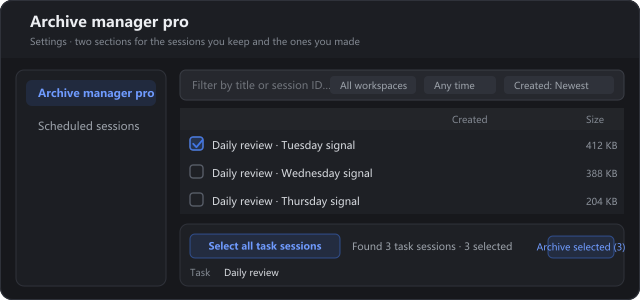

# dsh-archive-pro

English | [简体中文](./README.zh.md)

Bulk management for archived DeepSeek Harness sessions: search, filter, sort, multi-select, unarchive, and permanently delete — all from **Settings → Archive manager pro**.

A second section, **Settings → Scheduled sessions**, does the opposite job: it finds the sessions that scheduled tasks created and are not archived yet, selects them all in one click, and archives them.



## The problem

DeepSeek Harness ships with an archive feature but nothing to maintain it. Archiving a few dozen sessions leaves you with a flat, unsorted list: no search, no filters, no multi-select, and no way to reclaim disk space except clicking sessions one at a time. Archives keep their logs on disk forever, so the cost of that gap grows quietly.

The same gap exists in the other direction. A recurring scheduled task creates a fresh session on every trigger, and those sessions pile up in the sidebar until someone archives them by hand.

This plugin adds the maintenance layer the archive list is missing, on both sides.

## Features

| Capability | Detail |
| --- | --- |
| Keyword search | Matches session title **and** session ID |
| Workspace filter | One workspace, or sessions that never belonged to one |
| Log-state filter | Logs still on disk vs. leftover markers whose logs are gone |
| Age filter | Archived more than 7 / 30 / 90 days ago |
| Sorting | Created time, on-disk size, title — each in both directions |
| Multi-select | Checkbox per row, `Shift`-click to select a contiguous range |
| Select visible | Operates on the filtered set only, never sessions the filters hide |
| Batch unarchive | Return many sessions to their workspace sidebar at once |
| Batch delete | Permanent, with running tasks stopped and caches cleared |
| Purge visible | Clear the whole filtered list, skipping pinned sessions by default |
| Live stats | Matched count, combined size, selected count and selected size |

On-disk size is read from the real session log directory, so the heaviest archives are easy to target first.

## Scheduled sessions

**Settings → Scheduled sessions** handles the sessions a scheduled task created that are **not archived yet** — the opposite direction from the archive manager.

| Capability | Detail |
| --- | --- |
| One-click selection | Scans every task's delivery records and selects all task sessions that are still unarchived |
| Idle threshold | Only sessions whose latest delivery is older than the chosen window (1h / 6h / 24h / 7d / 30d) |
| Running tasks | A task whose latest delivery is still queued or executing is skipped entirely |
| Source task shown | Each row names the scheduled task that created it |
| Safe by construction | A task that delivers into a session you already had is never included |
| Batch archive | One confirmation, then every selected session is archived |
| Partial failures | One session failing never stops the rest; the failure is reported |
| Pinned sessions | Not selected automatically; select them by hand if you want |

**How the sessions are found.** DSH does not mark a session with the task that produced it — the schedule runtime creates sessions without any metadata. The only reliable record is the task's own delivery receipt, whose `targetSessionId` names the session that accepted the delivery. This plugin reads those receipts.

**A running task is never hit.** A delivery creates the session and the agent then performs that run, so the **time of the latest delivery** is when the run began. A session is only in range once that moment is older than the chosen threshold (one hour by default); a session delivered minutes ago is left alone. The task itself staying active does not matter — its next trigger creates a *new* session, and archiving the old one does not disturb it. When a task's latest delivery is still queued or executing, that whole task is skipped.

**Only task-created sessions count.** A scheduled task can target an existing session of yours (`target.kind === 'session'`), and those sessions are yours — they are never touched. Only tasks that create their own sessions (`new` and `new_once`) contribute to the list.

**Archiving is reversible.** It moves sessions out of the sidebar and into **Archive manager pro**, where they can be unarchived or permanently deleted like any other archived session. Nothing is deleted here.

> A scheduled task that keeps running still creates a new session on its next trigger. Pause or delete the task first if you want the inflow to stop.

The feature needs DSH's schedule service. Without it the section explains that it is unavailable instead of failing.

## Install

From the DSH app: **Settings → Plugins → Install**, then search for `dsh-archive-pro`.

Or from a terminal:

```bash
dsh plugin --profile web add dsh-archive-pro
```

The package is published on [npm](https://www.npmjs.com/package/dsh-archive-pro) as `dsh-archive-pro`.

After installing, open **Settings → Archive manager pro**, or **Settings → Scheduled sessions** for the task-created sessions.

## What permanent deletion does

Deleting an archived session is a controlled teardown, not just a directory removal:

1. Stops any task still running inside that session.
2. Closes the log writer and detaches the session from memory.
3. Removes the session log directory, the archive marker, and the projection cache.
4. Writes a deletion receipt so a late snapshot or cache write cannot resurrect the session.

Deletion cannot be undone. Unarchive remains available for as long as a session is only archived.

## Safety

- Everything runs locally. No telemetry, no uploads, no network requests.
- Deletion receipts live in `~/.dsh/storages/archive-manager-deleted.json` and contain session IDs only — never session content.
- Every destructive action opens a confirmation dialog naming the count and combined size first.
- `Esc` dismisses any confirmation dialog.
- Pinned sessions are skipped by **Purge visible** unless you turn that safeguard off.

## Requirements

- DeepSeek Harness desktop app (`engines.dsh: >=0.2.1`)
- Node.js ≥ 22 (bundled with DSH)
- Zero runtime dependencies

## How it fits into DSH

`package.json` declares both halves of a DSH bundle:

```json
"dsh": {
  "bundle": { "patch": "./cordis.patch.yml" },
  "client": { "platform": "web", "inject": [ ... ] }
}
```

- **Host half** (`lib/index.js`) injects `webServer`, `storageDomain`, `workspaceRegistry`, `sessionPersistence`, `sessions`, and `agents`, then mounts seven routes under `/dsh-archive-pro/*`.
- **Client half** (`client/client.js`) is a zero-build classic script loaded through `window.__ModuleLoader__.load`, registering two `settings.section` entries plus an optional native context-menu item.
- All session teardown is delegated to `lib/session-lifecycle.js`, which cancels agents, awaits idle/dispose, closes persistence writers, and clears memoized entries.
- Scheduled-session discovery lives in `lib/scheduled-sessions.js` and reads the optional schedule service lazily, so the plugin still loads without it.

## Repository layout

```
lib/index.js               Host entry: mounts routes, wires deletion reconciliation
lib/routes.js              list, restore, delete, batch-delete, batch-restore,
                           scheduled-sessions, archive
lib/scheduled-sessions.js  Discovery of task-created sessions
lib/session-lifecycle.js   Safe session / agent / writer teardown
client/client.js           Two settings sections + context menu (zero-build CJS module)
locale/zh.json             Chinese market metadata
locale/en.json             English market metadata
docs/DETAIL.md             English detail page (single feature image)
docs/DETAIL.zh.md          Chinese detail page (single feature image)
docs/preview.svg           Feature image, outlined to vector paths
icon.svg                   Plugin icon (36×36, self-contained)
cordis.patch.yml           Bundle patch inserting the plugin
```

## Development

There is no build step. Edit the files, install the directory as a bundle, then reload the DSH window.

```bash
# syntax check
node --check lib/index.js
node --check lib/routes.js
node --check lib/scheduled-sessions.js
node --check client/client.js

# tests
node test/scheduled-sessions.test.mjs
node test/scheduled-flow.test.mjs
node test/client.test.mjs
```

To install a local checkout while iterating:

```bash
dsh plugin --profile web add file:D:/path/to/dsh-archive-pro
```

Note that a locally linked directory bypasses the `files` whitelist, so
`node_modules` and scratch folders can still be picked up — keep the checkout clean.

## License

MIT. See [LICENSE](./LICENSE).

The session teardown logic grows out of [`dsh-archive-manager-plus`](https://www.npmjs.com/package/dsh-archive-manager-plus); this plugin adds filtering, sorting, multi-select, and batch operations on top of it.
