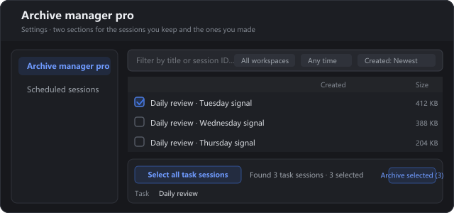

# dsh-archive-pro

[English](./README.md) | 简体中文

批量管理 DeepSeek Harness 的归档会话：搜索、筛选、排序、多选、取消归档、彻底删除，全部集中在 **设置 → 归档管理 Pro**。



## 它解决什么问题

DeepSeek Harness 自带归档功能，却没有配套的维护手段。归档几十个会话之后，只剩一个平铺的列表：不能搜索、不能筛选、不能多选，想回收磁盘空间只能一条条点。归档的日志会一直留在磁盘上，这个缺口带来的成本会静悄悄地涨。

这个插件补的正是这一层。

## 功能

| 能力 | 说明 |
| --- | --- |
| 关键词搜索 | 同时匹配会话标题**和**会话 ID |
| 工作区筛选 | 指定工作区，或筛选从未归属工作区的会话 |
| 日志状态筛选 | 区分日志仍在盘上 / 只剩残余标记 |
| 时间筛选 | 归档于 7 / 30 / 90 天前 |
| 排序 | 创建时间、磁盘体积、标题，各支持正反序 |
| 多选 | 每行复选框，`Shift` 点选连续区间 |
| 全选可见 | 只作用于筛选结果，不会误选被筛掉的会话 |
| 批量取消归档 | 一次把多个会话送回工作区侧边栏 |
| 批量删除 | 永久删除，同时停止运行任务并清理缓存 |
| 清空可见列表 | 一键清掉筛选结果，默认跳过已置顶会话 |
| 实时统计 | 命中条数、总体积、已选条数与已选体积 |

磁盘体积读取的是会话日志目录的真实占用，可以优先处理最占空间的存档。

## 安装

在 DSH 应用里打开 **设置 → 插件 → 安装**，搜索 `dsh-archive-pro`。

或在终端执行：

```bash
dsh plugin --profile web add dsh-archive-pro
```

安装后进入 **设置 → 归档管理 Pro**。

## 彻底删除做了什么

删除一条归档会话是一次受控拆解，而不是简单删目录：

1. 停止该会话中仍在运行的任务；
2. 关闭日志写入器，把会话从内存中卸载；
3. 删除会话日志目录、归档标记与投影缓存；
4. 写入删除回执，避免延迟到达的快照或缓存写入把会话复活。

删除不可撤销。只要会话仍处于归档状态，就始终可以取消归档。

## 安全性

- 全部操作在本机完成，无遥测、无上传、无网络请求。
- 删除回执存放在 `~/.dsh/storages/archive-manager-deleted.json`，只包含会话 ID，不含任何会话内容。
- 每个破坏性操作都会先弹出确认框，写明条数与合计体积。
- 按 `Esc` 可关闭任何确认框。
- 「清空可见列表」默认跳过已置顶会话，可在工具栏关掉这个保护。

## 环境要求

- DeepSeek Harness 桌面版（`engines.dsh: >=0.2.1`）
- Node.js ≥ 22（DSH 自带）
- 零运行时依赖

## 在 DSH 中的接入方式

`package.json` 同时声明了 DSH bundle 的两半：

```json
"dsh": {
  "bundle": { "patch": "./cordis.patch.yml" },
  "client": { "platform": "web", "inject": [ ... ] }
}
```

- **宿主半**（`lib/index.js`）注入 `webServer`、`storageDomain`、`workspaceRegistry`、`sessionPersistence`、`sessions`、`agents`，在 `/dsh-archive-pro/*` 下挂载 5 条路由。
- **客户端半**（`client/client.js`）是免构建的经典脚本，经 `window.__ModuleLoader__.load` 加载，注册一个 `settings.section`，以及可选的系统右键菜单项。
- 所有会话拆解都委托给 `lib/session-lifecycle.js`：取消运行中的任务、等待空闲/释放、关闭持久化写入器、清理缓存条目。

## 仓库结构

```
lib/index.js              宿主入口：挂载路由、接上删除对账
lib/routes.js             列表、取消归档、删除、批量删除、批量取消归档
lib/session-lifecycle.js  安全的会话 / 任务 / 写入器拆解
client/client.js          设置分区 + 右键菜单（免构建 CJS 模块）
locale/zh.json            中文市场元数据
locale/en.json            英文市场元数据
docs/DETAIL.md            英文详情页（单张功能图）
docs/DETAIL.zh.md         中文详情页（单张功能图）
docs/preview.svg          功能图，已轮廓化为矢量路径
icon.svg                  插件图标（36×36，自包含）
cordis.patch.yml          bundle 补丁，插入本插件
```

## 开发

没有构建步骤。改完文件，把目录作为 bundle 装上，刷新 DSH 窗口即可。

```bash
# 语法检查
node --check lib/index.js
node --check lib/routes.js
node --check client/client.js
```

本地迭代时安装工作副本：

```bash
dsh plugin --profile web add file:D:/path/to/dsh-archive-pro
```

注意：以本地目录链接方式安装会绕过 `files` 白名单，`node_modules` 和临时目录都可能被一并带入，请保持工作副本干净。

## 许可

MIT，见 [LICENSE](./LICENSE)。

会话拆解逻辑沿用自 [`dsh-archive-manager-plus`](https://www.npmjs.com/package/dsh-archive-manager-plus)，本插件在其之上加入了筛选、排序、多选与批量操作。
